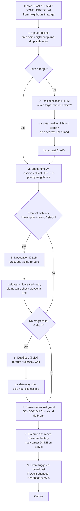

# Distributed LLM-Assisted Path Planning for Multi-UAV Systems

A simulation framework in which a **team of UAVs plans its own paths with no ground
station**: every aircraft runs an identical on-board planning stack, talks only to
neighbours inside radio range, and uses a **Large Language Model** for the
high-level decisions that need reasoning — which target to take, who yields in a
conflict, how to escape a deadlock — while a classical **space-time A\*** planner
guarantees collision-free geometry underneath.

```
                    mission targets, obstacles, no-fly zones
                                     │
   ┌─────────────────────────────────┼──────────────────────────────────┐
   │  UAV 0            UAV 1         │          UAV 2            UAV n  │
   │ ┌─────────┐     ┌─────────┐     │        ┌─────────┐      ┌───────┐│
   │ │  LLM    │     │  LLM    │     ▼        │  LLM    │      │  LLM  ││   high level: WHAT & WHO
   │ │ (Claude)│◄───►│ (Claude)│◄──radio────► │ (Claude)│ ...  │       ││   task choice, negotiation,
   │ ├─────────┤     ├─────────┤  (range-     ├─────────┤      ├───────┤│   deadlock escape
   │ │   A*    │     │   A*    │   limited,   │   A*    │      │  A*   ││   low level: HOW
   │ ├─────────┤     ├─────────┤   lossy)     ├─────────┤      ├───────┤│   exact obstacle-free path
   │ │ Sense & │     │ Sense & │              │ Sense & │      │Sense &││   safety: NEVER collide
   │ │  Avoid  │     │  Avoid  │              │  Avoid  │      │ Avoid ││   (sensor only, no radio)
   │ └─────────┘     └─────────┘              └─────────┘      └───────┘│
   └───────────────────────────────────────────────────────────────────┘
                         ▲  NO central planner anywhere  ▲
```

---

## 1. Problem statement

Given $N$ UAVs and $M$ mission points in an airspace with buildings and
restricted zones, each UAV must decide **which points to service and how to fly
to them** such that

1. every mission point is visited by exactly one UAV,
2. no two UAVs ever occupy the same cell or come closer than a safety distance,
3. total mission time (makespan) and distance flown are small,

**under distributed constraints**: no central computer, each UAV knows only
its own state plus what neighbours in radio range told it, and radio messages
can be lost. This is the *Multi-Agent Path Finding* (MAPF) problem combined
with *decentralised task allocation*, in the communication-constrained setting
typical of real UAV swarms.

## 2. Research background (what the literature says)

| Finding | Source | How this project uses it |
|---|---|---|
| LLMs fail at *cell-level* MAPF: they mis-locate obstacles, can't detect duplicate cells, and produce paths 3× optimal; performance collapses beyond a few agents. | Chen et al., *Why Solving MAPF with LLMs has not Succeeded Yet* (2024) | The LLM is **never** asked for a path. Geometry is done by A\*. |
| Using LLM-generated *waypoints* to guide A\* cuts search cost while keeping validity. | Meng et al., *LLM-A\** (2024); MMP-A\* (2026) | Reroute / deadlock answers may contain a waypoint; A\* runs *through* it, so a bad waypoint costs distance, never safety. |
| LLMs are effective for **deadlock detection & resolution** on top of a learned/classical low-level planner. | LLMDR (2025) | Deadlock handler asks the LLM to reroute, release the target, or wait. |
| Decentralised LLM goal assignment works when prompts are structured, contain explicit tie-break rules, and agents only see local information. | *Decentralized Multi-Agent Goal Assignment using LLMs* (2025) | Task-allocation prompt: structured JSON facts, local map excerpt, explicit checklist, deterministic tie-break. |
| LLM outputs must be **validated/projected onto feasible actions** before execution. | A2C-LLM (2026) "feasibility projection"; SkyAgent (2026) | Every LLM answer passes `_validate_*`; infeasible → safe default. |
| Decentralised MAPF for UAV traffic: *prioritisation* and *pairwise negotiation* resolve conflicts without a central authority. | Ho et al., *Decentralized MAPF for UAV Traffic Management* (2020) | Priority rule (fewer remaining steps › more waited › lower id) used for reservations; LLM negotiates proceed/yield/reroute pairwise. |
| **Event-triggered** communication + token/priority rules reduce bandwidth and avoid saturation in dense swarms. | Amangeldi (2025); *Where Paths Collide* survey (2025) | Agents broadcast only when their plan changes (plus a heartbeat). |
| Centralised swarms are brittle because they depend on the link to the server; decentralised policies that work from local observations are more deployable. | FF-PPO (2023); Vision-based distributed collision avoidance (2022) | The last-resort guard uses **only the on-board sensor** and still prevents collisions at 60 % packet loss. |

**Design conclusion:** a *hierarchical, hybrid* architecture — LLM for semantics,
search for geometry, a dumb-but-certain guard for safety — is what the evidence
supports.

## 3. System architecture

### 3.1 Module map

```
uavplan/
├── environment.py   grid airspace: obstacles (#), no-fly zones (~, soft), targets (T) with priority
├── planner.py       space-time A*: reservation table, vertex & swap conflicts, safety radius, waypoints
├── comms.py         radio: range-limited, probabilistic loss, event-triggered; PLAN/CLAIM/RELEASE/PROPOSAL/DONE
├── llm/
│   ├── prompts.py   three prompts (task, negotiation, deadlock) — local info only, strict JSON output
│   └── backend.py   ClaudeBackend (Anthropic SDK) · MockBackend (rule-based twin) · validation helpers
├── agent.py         ★ the per-UAV decision cycle — the distributed part
├── simulation.py    physics + radio + referee (metrics, collision check, narrative)
└── visualize.py     trajectory PNG, animated GIF
main.py              CLI
scripts/run_experiments.py   scalability / robustness / backend sweeps
tests/test_system.py         14 tests, no API key needed
```

### 3.2 One UAV's decision cycle (every time step)



### 3.3 Three layers, three guarantees

| Layer | Component | Information used | What it guarantees |
|---|---|---|---|
| **Semantic** | LLM (task, negotiation, deadlock) | local map excerpt, neighbour beliefs, messages | *Good* decisions: balanced task split, fewer waits, faster deadlock escape |
| **Geometric** | Space-time A\* with reservations | static map + higher-priority neighbours' announced paths | *Valid* paths: no obstacles, no planned conflicts with cooperating neighbours |
| **Safety** | Sense-and-avoid guard | on-board sensor only (3-cell range) | *No collisions*, even with 100 % message loss |

The safety proof is simple enough to state in one paragraph: two UAVs can
collide only by entering the same cell or swapping. Any cell a neighbour can
reach next step is within Chebyshev distance 1 of its *current* position, which
the sensor sees. The guard (i) never enters a cell a sensed UAV occupies and
(ii) when its next cell is within distance 1 of a sensed UAV, hovers unless it
has the lower id. Both sides see the same ids, so exactly one hovers. Because
the rule depends on nothing that could be out of date, lost messages cannot
break it. Whoever hovers re-plans around the other next step, so the cost is
one or two steps, not a deadlock.

### 3.4 The priority rule (used everywhere)

> **fewer remaining steps → more steps already waited → lower id**

It appears in the A\* reservation step, in the CLAIM-conflict resolution, in the
negotiation *prompt* given to the LLM, and in the validator that checks the
LLM's answer. Using one rule everywhere is what lets two UAVs that reason
*independently* reach *compatible* decisions.

### 3.5 Where exactly the LLM adds value

| Decision | Rule-based baseline (`MockBackend`) | What the LLM can do better |
|---|---|---|
| Task allocation | nearest unclaimed target, priority-weighted | weigh priority vs. distance vs. neighbour positions vs. battery; read a neighbour's CLAIM and back off |
| Conflict negotiation | fixed tie-break | choose *reroute with a sensible waypoint* instead of blind waiting when the map excerpt shows open space |
| Deadlock | perpendicular sidestep | read the local map, propose a detour on the correct side, or decide the target is better released |

Both backends speak the identical JSON protocol, so the experiment script can
swap them on the same seeds for a fair comparison.

## 4. Communication protocol

| Message | Sent when | Payload |
|---|---|---|
| `PLAN` | plan changed (event) or every 5 steps (heartbeat) | position, next 25 cells, target, remaining, waited |
| `CLAIM` | a target is chosen | target id, straight-line distance (for consistent dispute resolution) |
| `RELEASE` | target given up (deadlock) | target id |
| `PROPOSAL` | conflict negotiation (unicast) | with, action, wait_steps |
| `DONE` | target reached | target id (gossips through the network) |

Range-limited: only UAVs within `comm_range` receive anything. Lossy:
each delivery fails with probability `loss`. No acknowledgements — the
protocol is designed to tolerate that.

## 5. Installation & running

```bash
cd uav_llm_planner
pip install -r requirements.txt          # numpy, matplotlib, anthropic, pytest

# 1. run the tests (offline, ~5 s)
python -m pytest -q

# 2. one mission with the rule-based stand-in, plot + animation + decision narrative
python main.py --uavs 6 --targets 10 --size 36 --density 0.16 --seed 3 --plot --gif --explain

# 3. same mission, but every UAV's decisions are made by Claude
export ANTHROPIC_API_KEY=sk-ant-...
export UAV_LLM_MODEL=claude-sonnet-4-6     # optional, any current Claude model
python main.py --uavs 4 --targets 6 --backend claude --seed 1 --plot --explain --transcript

# 4. harsh radio: 5-cell range, 40 % packet loss
python main.py --uavs 10 --targets 14 --size 40 --comm-range 5 --loss 0.4 --plot

# 5. evaluation sweeps (add --with-claude for the backend comparison)
python scripts/run_experiments.py --seeds 5
```

`--transcript` writes every prompt the LLM saw and every JSON it returned to
`results/llm_transcript_*.json` — useful for a viva, since you can show exactly
what a UAV "thought" at a given step. `--explain` prints a timeline per UAV:

```
UAV 5: start (12, 35), visited [3, 0], flew 12.1 cells, waited 2 steps
  t=  0  claim_target   {'target': 3, 'reason': 'nearest unclaimed ...'}
  t=  4  target_reached {'target': 3}
  t=  6  sense_avoid_hover {'near': 1}
  t=  7  release_target {'target': 7, 'reason': 'UAV 1 closer'}
  t=  7  replan         {'target': 5, 'length': 26, 'avoided': [1]}
```

## 6. Results (rule-based backend, 4 seeds per row, `scripts/run_experiments.py`)

| Experiment | Config | Success | Collisions | Near misses | Makespan | Distance | Waits | Msgs | LLM calls |
|---|---|---|---|---|---|---|---|---|---|
| scalability | 4 UAVs / 6 targets / 30² | 100 % | 0 | 0.5 | 26.3 | 113 | 5.5 | 62 | 20 |
| scalability | 8 / 12 / 40² | 100 % | 0 | 1.8 | 35.8 | 293 | 29 | 178 | 65 |
| scalability | 12 / 16 / 45² | 100 % | 0 | 3.8 | 29.3 | 347 | 49 | 268 | 113 |
| scalability | 16 / 20 / 50² | 100 % | 0 | 1.8 | 26.8 | 441 | 41 | 300 | 119 |
| robustness | loss 0 % / range 8 | 100 % | 0 | 1.8 | 35.8 | 293 | 29 | 178 | 65 |
| robustness | loss 20 % / range 6 | 100 % | 0 | 2.3 | 36.0 | 296 | 30 | 172 | 62 |
| robustness | loss 40 % / range 5 | 100 % | 0 | 5.5 | 37.8 | 308 | 36 | 184 | 68 |
| robustness | loss 60 % / range 4 | 100 % | 0 | 6.0 | 37.3 | 306 | 41 | 181 | 62 |

Additional stress run during development: 20 UAVs, 24 targets, 25 % obstacle
density, 60 % packet loss, comm range 4 → 11/11 missions complete, **0 collisions**.

What the numbers show:

* **Safety is independent of communication quality** — collisions stay at zero
  from 0 % to 60 % loss; only near-misses and hover steps rise, which is the
  expected graceful degradation.
* **Makespan does not grow with team size** because work is split
  automatically (16 UAVs finish 20 targets in the same time 4 UAVs finish 6).
* **LLM calls grow roughly linearly** with UAVs (≈ 7–8 decisions per UAV per
  mission), which is what makes a real LLM affordable: the geometry is free.

## 7. Design decisions worth explaining

1. **Why not let the LLM plan paths?** Evidence (Chen et al. 2024) shows it
   fails beyond trivial maps. Our LLM calls are ~100 per mission; A\* runs
   thousands of times at zero cost and never makes a geometric mistake.
2. **Why validate the LLM's output?** A hallucinated `"target": "banana"` or a
   waypoint inside a building must not crash the loop (`test_llm_answers_are_validated`
   runs the whole mission with a backend that returns garbage: 0 collisions, all targets done).
3. **Why a static id tie-break in the guard but a dynamic one everywhere else?**
   Dynamic priorities are *better* (the UAV closest to its goal gets through) but
   require both sides to hold the same information, which packet loss breaks.
   The guard is the one place where being wrong is unacceptable, so it uses only
   information that can't be stale. Efficiency and safety are split across layers.
4. **Why time-shift neighbour beliefs?** A plan heard 3 steps ago is indexed from
   3 steps ago. Reading `path[1]` as "their next cell" was an early bug that caused
   collisions; `NeighbourBelief.cell_at(t, k)` fixes it.
5. **Why a 3-cell sensor range?** Two UAVs at Chebyshev distance 2 (Euclidean up to 2√2 ≈ 2.83)
   can enter the same cell in one step, so the sensor must see at least that far.
6. **Why event-triggered broadcasts?** Bandwidth. With 16 UAVs, ~300 messages
   per mission instead of 16 × steps × neighbours.

## 8. Limitations and extensions

* 2-D grid at fixed altitude; a 3-D grid is a one-line change to `MOVES` and `neighbors()`.
* Kinematics are ignored (unit step per tick); a real deployment would feed the
  cell path to a trajectory smoother / MPC.
* Targets are known from the mission briefing; discovering targets on the fly
  only needs a new `DISCOVERED` gossip message.
* The LLM is called synchronously; on real hardware one would call it
  asynchronously with the rule-based policy as the fallback while waiting.
* Battery is a step counter; energy-aware allocation (return-to-base) is a natural extension to the task prompt.

## 9. References

1. Chen, W. et al. *Why Solving Multi-agent Path Finding with Large Language Models has not Succeeded Yet.* 2024.
2. Meng, S. et al. *LLM-A\*: Large Language Model Enhanced Incremental Heuristic Search on Path Planning.* EMNLP Findings 2024.
3. *LLMDR: LLM-Driven Deadlock Detection and Resolution in Multi-Agent Pathfinding.* 2025.
4. *Decentralized Multi-Agent Goal Assignment for Path Planning using Large Language Models.* 2025.
5. *LLM-PD: A Large Language Model-Driven Policy Distillation-Based Method for Multi-UAV Path Planning.* IEEE 2026.
6. *SkyAgent: A lightweight LLM-driven RL framework for adaptive cooperative path planning of two UAVs.* 2026.
7. *A2C-LLM: An Actor-Critic-Enhanced LLM for UAV Swarm Multi-Target Task Allocation.* Drones, 2026.
8. Ho, F. et al. *Decentralized Multi-Agent Path Finding for UAV Traffic Management.* IEEE T-ITS 2020.
9. Li, W. et al. *Multi-Agent Path Finding with Prioritized Communication Learning (PICO).* ICRA 2022.
10. Amangeldi, A. *Decentralized Trajectory Planning and Event-Triggered Communication for Multi-UAV Navigation.* 2025.
11. *Where Paths Collide: A Comprehensive Survey of Classic and Learning-Based Multi-Agent Pathfinding.* 2025.
12. Bayerlein, H. et al. *Multi-UAV Path Planning for Wireless Data Harvesting with Deep RL.* IEEE 2021.
13. *Intent-Driven Cooperative Control of UAV Swarms: An LLM-Based Approach.* Applied Sciences 2026.
14. *Multi-UAV Path Planning in GPS and Communication Denial Environment (FF-PPO).* Sensors 2023.
